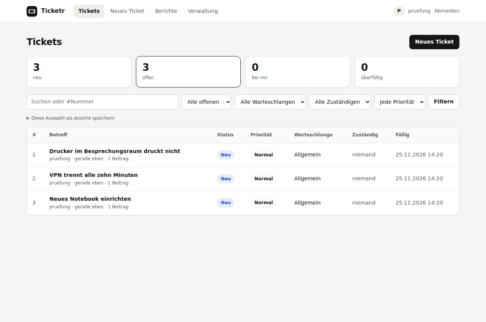
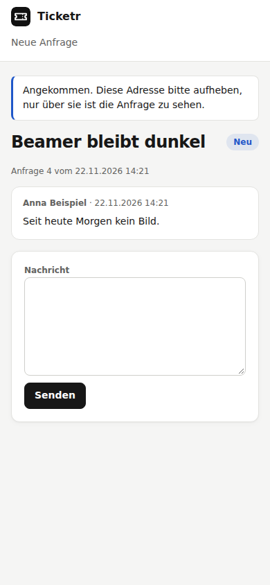

<p align="center"></p>
<h1 align="center">Ticketr</h1>
<p align="center">Ticketsystem für Anfragen, Störungen und Aufgaben. Ein Go-Programm und PostgreSQL, mehr nicht.</p>

<p align="center">

[](https://github.com/Dschonas04/ticketr/actions/workflows/pruefen.yml)
[](https://go.dev)
[](https://www.postgresql.org)
[](LICENSE)

</p>



## Was es kann

| Bereich | Funktionen |
|---|---|
| Tickets | Status, Priorität, Zuständigkeit, Verlauf, interne Notizen, Anhänge, Antwortvorlagen |
| Überblick | Kennzahlen, Filter, Suche im Text, `#Nummer`, gespeicherte Ansichten je Person, Berichte |
| Warteschlangen | je Team, neue Tickets sortieren sich über Stichworte selbst ein |
| Fristen | Lösung und erste Antwort nach Priorität, je eine Erinnerung vor Ablauf |
| E-Mail | Eingang per IMAP, Antworten per SMTP, Zuordnung über `[#Nummer]` und Absender |
| Kundenportal | Anfragen ohne Konto, Stand über einen geheimen Link |
| Anbindung | `GET /api/tickets`, Webhook mit Unterschrift |
| Anmeldung | OIDC (etwa Keycloak) oder eigene Konten, Rollen Agent und Admin |

## Starten

```bash
cp .env.beispiel .env            # Kennwort für die Datenbank eintragen
docker compose up -d --build
docker compose logs ticketr      # Link mit Einrichtungscode
```

Danach läuft Ticketr unter `http://<host>:8350`. Das erste Konto aus dem Link
verwaltet die App. Wer nur OIDC benutzt, trägt den Admin in `TICKETR_ADMIN` ein.
Für den Betrieb gehört TLS davor (Caddy, nginx).

## Fristen

| Priorität | erste Antwort | Lösung |
|---|---|---|
| dringend | 1 Stunde | 4 Stunden |
| hoch | 6 Stunden | 1 Tag |
| normal | 18 Stunden | 3 Tage |
| niedrig | 42 Stunden | 7 Tage |

Erinnert wird 15 Minuten vor der ersten Antwort und eine Stunde vor der Lösung,
im Verlauf und, mit SMTP, per Mail an die zuständige Person.

## Einstellungen

Alles Optionale ist aus, bis es in der `.env` steht.

| Variable | Bedeutung |
|---|---|
| `TICKETR_ADMIN` | Admins: `oidc:<Aussteller>\|<sub>` oder `konto:<Name>`, mit Komma getrennt |
| `TICKETR_PORTAL=1` | Kundenportal unter `/hilfe`, ohne Anmeldung erreichbar |
| `TICKETR_SMTP` | `host:587`, dazu `_SMTP_NUTZER`, `_SMTP_KENNWORT` und `TICKETR_ABSENDER` |
| `TICKETR_IMAP` | `host:993`, immer TLS, dazu `_IMAP_NUTZER`, `_IMAP_KENNWORT`, `_IMAP_ORDNER` |
| `TICKETR_WEBHOOK` | Adresse für `ticket.neu`, `ticket.antwort`, `ticket.status`, `ticket.frist` |
| `TICKETR_WEBHOOK_GEHEIMNIS` | unterschreibt den Inhalt: `X-Ticketr-Signatur: sha256=<HMAC>` |
| `TICKETR_SSO_AUS=1` | Notausgang, schaltet die Anmeldung ab |

## Kundenportal



Im Portal stehen nur Antworten, nie interne Notizen. Der Link ist der einzige
Zugang, gespeichert ist davon nur der Hash.

## E-Mail-Eingang

Jede Minute holt Ticketr ungelesene Mails und markiert sie erst als gelesen, wenn
sie gespeichert sind. Automatische Antworten und Listenmails bleiben draußen.
HTML wird nie angezeigt, sondern hängt als Datei an. Eine Antwort landet nur dann
im Ticket, wenn die Absenderadresse die der meldenden Person ist. Absender lassen
sich fälschen: Das Postfach sollte SPF und DMARC prüfen.

## Entwickeln

```bash
go run .
go test ./...
# mit Datenbank; sie wird geleert, der Name muss mit pruef beginnen
TICKETR_TEST_DB=postgres://.../pruef_ticketr go test ./...
```

Go 1.27.4, PostgreSQL 17. Das Schema steht in `schema.sql` und spielt sich beim
Start selbst ein.

## Lizenz

MIT, siehe [LICENSE](LICENSE).
